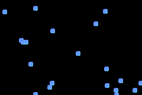

# Bouncers
Bouncers is a game where you spawn in dots with random coordinates, watch them bounce of the wall, and watch them each despawn after 12 seconds.

## How to Play

- **A Button** Spawns in a new dot
- **B Button** Enters the average x position of all active (not despawned) dots into the debug console

You can have up to 20 dots on the screen at the same time.

## Gameplay

## Play Now!

[Play Bouncers](https://bmitzel88.github.io/bouncers/)
